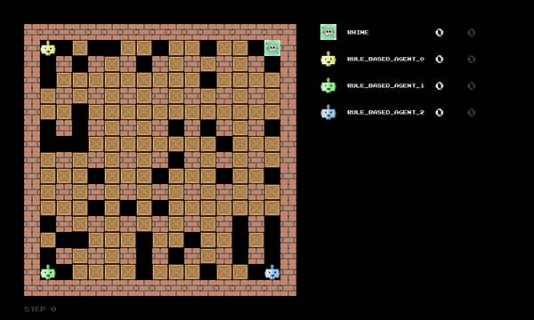

# RHINE: a curriculum-trained PPO agent for Bomberman

<p align="center"></p>
<p align="center"><em>One game against three <code>rule_based_agent</code>s. Individual games vary widely. Average results are given under <a href="#results">Results</a>.</em></p>

RHINE is a PPO agent for four-player Bomberman. Against three copies of the course's full-strength `rule_based_agent`, it averages 6.33 points per game against 5.04 for the best opponent (+26%) and finishes first in 63% of games (53% alone).

RHINE was my individual part of a group project in the course *Machine Learning Essentials* at Heidelberg University (summer semester 2026). I designed, implemented, trained and evaluated it alone, and this repository contains only my own work.

## Approach

**A learned policy inside safety rules.** A PPO actor-critic (shared trunk of two 64-unit tanh layers, policy and value heads, clipped objective with generalized advantage estimation) acts on 31 engineered features built from breadth-first-search distances, blast coverage and time-dependent danger. No feature encodes a recommended action. A rule-based mask removes illegal actions and actions that lead to a known, unavoidable death, for example a bomb without an escape route. The mask is active in training as well as in evaluation, so the policy only ever learns and chooses among safe actions.

**A curriculum planned stage by stage.** The course suggests four tasks of increasing difficulty: coins on an empty board, crates and bombs, passive and coin-collecting opponents, and the full-strength `rule_based_agent`. Within these I planned the training stages myself:

- Tasks 1 and 2 were trained on boards with 50 coins, which give many reward events while a skill is learned, and transferred zero-shot to the 9-coin boards. No fine-tuning was needed.
- Task 3 was split into four stages, one and then three opponents of each kind, so that every new failure mode could be traced to a single change.
- Every task and stage was trained from random initialization, so each result reflects that stage's own feature and reward design.

**Monitoring and checkpoint selection.** Training was interleaved with periodic evaluation games, which showed when and how performance collapsed instead of only the final outcome. The final checkpoint was the best by score among the top five periodic evaluations, after discarding those whose self-kill, oscillation or killed-by-opponent rate clearly exceeded the median. These selection games used a separate evaluation seed, so selection and final evaluation are independent.

## Results

Task 4 against three `rule_based_agent`s on the `classic` scenario: 100 games per training seed (evaluation seed 1000), mean ± sample standard deviation over three training seeds. A coin is worth 1 point and a kill 5 points.

| Agent | Score | Kills | Self-kill rate | Killed-by-opponent rate | Oscillation fraction |
|---|---|---|---|---|---|
| Task 3 agent, zero-shot | 5.00 ± 0.54 | 0.34 ± 0.07 | 0.153 ± 0.104 | 0.107 ± 0.006 | 0.007 ± 0.012 |
| Task 4 agent (final) | 6.33 ± 0.76 | 0.58 ± 0.19 | 0.113 ± 0.025 | 0.130 ± 0.026 | 0.007 ± 0.006 |

- **Against the opponents.** In the same games, the best of the three opponents averaged 5.04 points. RHINE finished first in 63% of games and alone in first place in 53%. Under a second evaluation seed (2000), it scored 6.11 against 4.84 and finished alone in first place in 52% of games.
- **Gain from Task 4 training.** Compared with the Task 3 agent evaluated zero-shot, training against the `rule_based_agent` raised the score by 1.33 points (standard error 0.30 over 300 games). The gain came from more kills, not from fewer deaths.
- **Decision time.** All evaluations ran with the per-step thinking-time limit disabled, so that machine load could not force WAIT actions. Measured separately in 20 games, the final agent decided in 15.8 ms on average (maximum 125.2 ms), well below the 0.5 s limit.

## Key findings

- **Opponents can make rewards sparse.** Against a single coin-collecting opponent, kills were too rare for the value of attacking to be learned, and the bombing probability was almost uncorrelated with the kill-target features. With three opponents, the agent took 66% of its kill opportunities. It had learned to attack, but not yet to aim.
- **Reward shaping depends on reward density.** It destabilized learning on the dense coin board but was indispensable once crates made rewards sparse.
- **Oscillation is a limit of the state, not of the reward.** The policy sees no history, so it cannot tell how long it has been stepping back and forth, and reward penalties alone could not stop the loop. An evaluation-only oscillation breaker reduced oscillating games from 11 to 0 of 300 at no cost in score. It is a rule, not a learned skill.
- **Most remaining deaths are outside the agent's control.** 50 of the 73 deaths of the final agent (68%) followed a lost same-step contest for the tile it needed to escape. The game decides such contests by a random processing order after the actions are submitted, so neither the mask nor training can change them.
- **Attacking is limited by opportunity.** When an opponent was trapped in the blast with no safe path out, RHINE bombed in 87% of such steps. The next step for improvement is therefore creating traps, not a higher kill reward.
- **Training seeds matter.** Scores differ between training seeds from 5.64 to 7.15 points per game, more than the gain from Task 4 training.

## Repository layout

```
agent_code/
  rhine/            Agent code, the final checkpoint (models/), training and evaluation scripts (scripts/) and tests (tests/)
media/              Demo animation used in this README
patches/
  agents_logging.patch   Logging fix applied to the framework's agents.py by setup.sh
report/
  rhine_report.pdf  Full report on RHINE
  rhine_report.tex  LaTeX source of the report
  figures/          Figures used in the report
setup.sh            Downloads the framework into framework/ and links the agent into it
requirements.txt    Python dependencies (install PyTorch separately, see below)
LICENSE             MIT license for the code in this repository
```

## Installation

Requires Python 3.12 and git. Tested on Linux (WSL2).

```bash
python3.12 -m venv .venv
source .venv/bin/activate
pip install torch==2.13.0 --index-url https://download.pytorch.org/whl/cpu
pip install -r requirements.txt
bash setup.sh
```

`setup.sh` clones the course framework into `framework/`, checks out a fixed commit, links `agent_code/rhine` into `framework/agent_code/` and applies `patches/agents_logging.patch`. It can be run again safely.

## Usage

All commands are run from `framework/` (`cd framework`). RHINE loads the final checkpoint `agent_code/rhine/models/task4_seed0.pt` with its final settings by default.

```bash
# Watch one game against three rule_based_agents
python main.py play --agents rhine rule_based_agent rule_based_agent rule_based_agent

# 100 games without GUI, statistics saved to results/
python main.py play --agents rhine rule_based_agent rule_based_agent rule_based_agent --no-gui --n-rounds 100 --save-stats

# Tests
python -m pytest agent_code/rhine/tests -q

# Training of the Task 4 agent for one seed (the checkpoint path must be absolute)
python -m agent_code.rhine.scripts.run_stage_a2_task3 --stage TASK4 --seed 0 \
    --checkpoint-path-override "$PWD/agent_code/rhine/models/my_task4_seed0.pt"
```

In GUI mode the framework waits for a key press after each round. Use `--help` on any script for its options.

## Report

Full details on the method, training, experiments and results are in [report/rhine_report.pdf](report/rhine_report.pdf).

## Acknowledgements and sources

The game framework is the course framework at https://github.com/ukoethe/bomberman_rl, used at commit `0f55c1d207e586e6fe6db95e64302ed32281e370`. The upstream repository does not state a license, so this repository does not include any framework code. `setup.sh` downloads it from the original repository.

The design decisions, experiments and analysis are my own. I used AI coding assistants during implementation.

## License

The code in this repository is released under the MIT License (see [LICENSE](LICENSE)). The license does not apply to the upstream framework.
