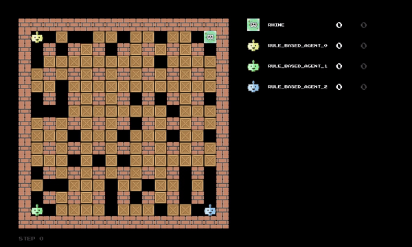

# RHINE: a curriculum-trained PPO agent for Bomberman

Author: Qin Yan

<p align="center"></p>
<p align="center"><em>One game against three <code>rule_based_agent</code>s. Individual games vary widely. Average results are given under <a href="#results">Results</a>.</em></p>

RHINE is a PPO agent for four-player Bomberman that acts on 31 engineered features under a rule-based safety mask. Trained from scratch through a staged curriculum, it beats three scripted `rule_based_agent`s, scoring 6.33 points per game against 5.04 for the best opponent and finishing alone in first place in 53% of games.

It was developed as the author's individual part of a group project in the course *Machine Learning Essentials* at Heidelberg University (summer semester 2026). This repository contains only the author's own work.

## Method

- **PPO actor-critic.** A multilayer perceptron with a shared trunk of two 64-unit tanh layers, a policy head over the six actions and a value head, trained with the clipped PPO objective and generalized advantage estimation.
- **31 engineered features.** Computed from breadth-first-search distances, blast coverage and time-dependent danger. No feature encodes a recommended action.
- **Rule-based action mask.** Removes illegal actions and actions that lead to a known, unavoidable death. The policy chooses among the remaining ones, in training and in play.
- **Oscillation breaker.** An evaluation-only refinement of the mask that stops the agent from stepping back and forth between two tiles. It is never active during training.
- **Four-task curriculum.** The course defines four tasks, from coin collection to stronger opponents such as the `rule_based_agent`. The training stages within them were designed by the author, for example four opponent stages in Task 3. Every task and stage was trained from scratch, without weight transfer.

## Results

Task 4 against three `rule_based_agent`s on the `classic` scenario: 100 games per training seed (evaluation seed 1000), mean ± sample standard deviation over three training seeds, oscillation breaker on.

| Agent | Score | Kills | Self-kill rate | Killed-by-opponent rate | Oscillation fraction |
|---|---|---|---|---|---|
| Task 4 agent | 6.33 ± 0.76 | 0.58 ± 0.19 | 0.113 ± 0.025 | 0.130 ± 0.026 | 0.007 ± 0.006 |

In the same games, the best of the three opponents averaged 5.04 points per game, and RHINE finished alone in first place in 53% of games (63% including ties). Under a second evaluation seed (2000), RHINE scored 6.11 against 4.84 and finished alone in first place in 52% of games.

All evaluations ran with the per-step thinking-time limit disabled, so that load on the evaluation machine could not force WAIT actions. Measured separately in 20 games, the final agent's decision time averaged 15.8 ms (maximum 125.2 ms), well below the 0.5 s limit.

## Key findings

- Oscillation turned out to be a limitation of the Markovian state rather than of the reward. The evaluation-time breaker removed it at no cost in score, although it is a rule, not a learned skill.
- Reward shaping destabilized learning on the dense coin board but was indispensable once crates made rewards sparse.
- Most remaining deaths come from losing a same-step contest for a tile, which the agent cannot control.
- Scores differ substantially between training seeds, from 5.64 to 7.15 points per game.

## Repository layout

```
agent_code/
  rhine/            Agent code, the final checkpoint (models/), training and evaluation scripts (scripts/) and tests (tests/)
media/              Demo animation used in this README
patches/
  agents_logging.patch   Logging fix applied to the framework's agents.py by setup.sh
report/
  rhine_report.pdf  Full report on RHINE
  rhine_report.tex  LaTeX source of the report
  figures/          Figures used in the report
setup.sh            Downloads the framework into framework/ and links the agent into it
requirements.txt    Python dependencies (install PyTorch separately, see below)
LICENSE             MIT license for the code in this repository
```

## Installation

Requires Python 3.12 and git. Tested on Linux (WSL2).

```bash
python3.12 -m venv .venv
source .venv/bin/activate
pip install torch==2.13.0 --index-url https://download.pytorch.org/whl/cpu
pip install -r requirements.txt
bash setup.sh
```

`setup.sh` clones the course framework into `framework/`, checks out a fixed commit, links `agent_code/rhine` into `framework/agent_code/` and applies `patches/agents_logging.patch`. It can be run again safely.

## Usage

All commands are run from `framework/` (`cd framework`). RHINE loads the final checkpoint `agent_code/rhine/models/task4_seed0.pt` with its final settings by default.

```bash
# Watch one game against three rule_based_agents
python main.py play --agents rhine rule_based_agent rule_based_agent rule_based_agent

# 100 games without GUI, statistics saved to results/
python main.py play --agents rhine rule_based_agent rule_based_agent rule_based_agent --no-gui --n-rounds 100 --save-stats

# Tests
python -m pytest agent_code/rhine/tests -q

# Training of the Task 4 agent for one seed (the checkpoint path must be absolute)
python -m agent_code.rhine.scripts.run_stage_a2_task3 --stage TASK4 --seed 0 \
    --checkpoint-path-override "$PWD/agent_code/rhine/models/my_task4_seed0.pt"
```

In GUI mode the framework waits for a key press after each round. Use `--help` on any script for its options.

## Report

Full details on the method, training, experiments and results are in [report/rhine_report.pdf](report/rhine_report.pdf).

## Acknowledgements and sources

The game framework is the course framework at https://github.com/ukoethe/bomberman_rl, used at commit `0f55c1d207e586e6fe6db95e64302ed32281e370`. The upstream repository does not state a license, so this repository does not include any framework code. `setup.sh` downloads it from the original repository.

Implementation was AI-assisted. The design decisions, experiments and analysis were directed by the author.

## License

The code in this repository is released under the MIT License (see [LICENSE](LICENSE)). The license does not apply to the upstream framework.
